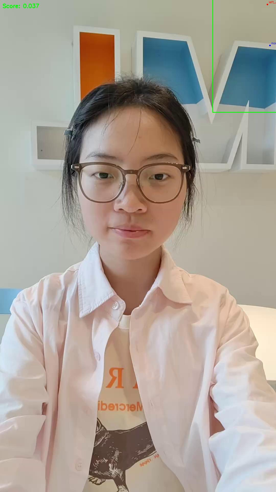

# RetinaFace 人脸检测

基于 PyTorch 的 RetinaFace 人脸检测实现，包含骨干网络、FPN、Anchor 生成、检测头和训练/推理脚本。



## 文件说明

| 文件 | 作用 |
| --- | --- |
| `3_backbone.py` | 骨干网络 |
| `4_fpn.py` | 特征金字塔 |
| `5_retinaface.py` | RetinaFace 主体结构 |
| `retinaface_model.py` | 模型封装 |
| `anchor.py` / `anchors.py` | 先验框生成 |
| `dataset.py` | 数据加载 |
| `losses.py` | 分类、框回归、关键点损失 |
| `train.py`、`train_config.py` | 训练入口与配置 |
| `detect.py`、`11new_detect.py` | 单图检测（基础版 / 含 Anchor 解码 + NMS 的进阶版） |
| `test.py`、`check_anchors.py` | 权重加载测试、Anchor 数量自检 |
| `7_config.py` | 训练与推理参数配置 |
| `plot_train_log.py` | 训练日志画 loss 曲线、汇总最优轮次 |

## 模型结构

```text
输入图像
  → ResNet 骨干
  → FPN 多尺度特征
  → Anchor 生成
  → 分类 / 边框回归 / 五点关键点
  → NMS
  → 人脸框与关键点
```

## 运行

推理：

```bash
python detect.py
```

运行前修改 `detect.py` 和 `7_config.py` 里的图片路径、模型权重路径。

训练：

```bash
python train.py
```

数据集按 WIDER FACE 目录组织，路径在 `train_config.py` 中修改。

依赖：

```bash
pip install -r requirements.txt
```

训练曲线：

```bash
# 训练时每轮把 epoch,train_loss,val_loss(,mAP) 写进 CSV
python plot_train_log.py --log train_log.csv --out train_curves.png
python plot_train_log.py --demo        # 没有日志时先看输出效果
```

## 关于指标

训练日志和权重体积较大，没有随仓库上传，因此这里不贴具体 mAP 数字，避免给出无法复现的结果。
仓库提供的是完整的结构与训练流程，复现方式：

1. 按 `train_config.py` 里的路径放好 WIDER FACE 数据集
2. `python train.py` 训练，日志写入 CSV
3. `python plot_train_log.py --log train_log.csv` 得到 loss 曲线
4. `python detect.py` 在单张图片上验证检测效果

## 数据与权重

- `best_model.pth` 约 278 MB，未上传，请用训练脚本自行生成或从 release 下载
- 人脸数据集未上传，避免仓库过大和版权问题
- `detect_result.jpg` 是推理结果示例

## 说明

这是深度学习实训中的人脸检测项目，重点在 RetinaFace 的多尺度检测和关键点回归，不追求刷榜指标。
